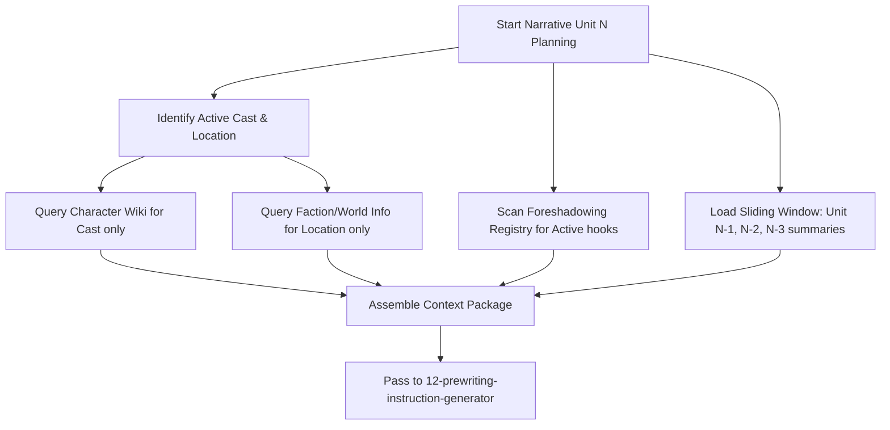

# Lore Book & Global Setting Database Maintenance

Use this when the user or system needs to merge narrative-unit memory into the global setting database (Lore Book), resolve setting conflicts, or query/retrieve relevant settings for writing Narrative Unit N.

This module acts as the "database administrator" for long-term narrative consistency. It processes the output of `references/09-memory-update.md` and feeds retrieved content into `references/12-prewriting-instruction-generator.md`.

```text
09-memory-update -> [10-lore-database-maintenance (Merge)] -> Global Database
Global Database -> [10-lore-database-maintenance (Recall)] -> 12-prewriting-instruction-generator
```

---

## 1. Global Database Structure

The Global Setting Database (Lore Book) must maintain the following structured files or data nodes:

1. **World Settings (世界观与法则)**: Magic/power systems, laws, technology, history, geography, factions.
2. **Character Wiki (人物志)**: Surface cards, inner psychology, abilities, inventory, and character stages (personality changes over time).
3. **Relationship Graph (人物关系网络)**: Direct graph of character connections with edges defining intimacy, alliance, hostility, or secret leverage.
4. **Foreshadowing Registry (伏笔挂盘)**: Registry of active, developing, and resolved foreshadowing keys with narrative-unit markers.
5. **Narrative Timeline (编年史与故事线)**: Chronological order of events that have occurred in the story.

---

## 2. Local-to-Global Merge Protocol (局部记忆合并机制)

Whenever a narrative unit is finalized and its local memory is extracted via `references/09-memory-update.md`, run this merge protocol to update the global database.

### 2.0 Lore Ingestion Position Gate

Before merging local chapter memory into the global database, verify the `章节位置校验` section from `references/09-memory-update.md`.

Read or re-check these sources when available:

1. Chapter outline, plus `大纲/02-章节细纲索引.md` only if the project actually maintains a chapter-detail index
2. Total outline, volume outline, or volume plan
3. Author-confirmed project structure
4. Previous and next chapter memory, if needed for continuity

If the local memory says `是否卷末: 是`, `是否阶段 / 弧线收束: 是`, `本卷结束`, `主线告一段落`, `全书进入尾声`, or similar long-range status, merge that claim only when it has explicit outline/index/volume/total-outline/author support.

Do not block lore merge only because `大纲/02-章节细纲索引.md` is absent in a project that does not use it. Treat that file as optional unless the project explicitly depends on it.

If support is missing, do not merge the claim as canon. Downgrade it to `未确认`, record a merge warning, and keep only chapter-level facts such as ending hook, payoff, emotional aftertaste, character state, relationship state, foreshadowing, and timeline event.

```markdown
### 入库位置校验
- 章节记忆文件:
- 已核对来源:
- 缺失来源:
- 章节位置结论:
- 卷 / 阶段 / 全书状态结论: [已确认 / 未确认 / 不入库]
- 被拒绝或降级的状态表述:
- 处理方式:
```

### 2.1 Merge Priority Rules
If a new fact from the narrative-unit memory conflicts with an existing global setting, use the following resolution priority:
1. **User Direct Override**: If the user explicitly approved a change in the story, update the global setting and add a migration comment.
2. **Canon Supremacy (铁律优先)**: If the new fact contradicts a core world law or major protagonist backstory without user permission, flag it as a **Canon Violation** and reject the merge.
3. **Recency Rule (近因效应)**: For dynamic variables (e.g., character health, location, immediate relationships), the latest narrative-unit memory overrides older records.
4. **Uncertainty Flag**: If a character's state change is speculative (e.g., "appears dead but body not found"), store it with an `[Unconfirmed]` tag.

### 2.2 Merge Operation Checklist

```markdown
### 设定合并自检表
- [ ] **入库位置校验**：核对章节记忆的 `章节位置校验`，不把缺少大纲/索引/卷纲/总纲/作者依据的卷末、阶段收束、全书尾声判断写入全局设定库。
- [ ] **人物卡更新**：检查是否有新增性格阶段、技能变化、道具获得/遗失，并同步到对应人物 Wiki。
- [ ] **关系网更新**：检查是否有盟友变敌对、秘密泄露等，更新关系图谱上的边属性。
- [ ] **伏笔更新**：
  - 如果伏笔被收回，将状态变更为 `[Resolved]`，并记录收回叙事单元。
  - 如果埋下新伏笔，在 Registry 中新建 `[Active]` 条目。
- [ ] **时间线追加**：将本单元核心事件以“第 N 天/年”或“叙事单元 N”为锚点，追加进全局故事线。
- [ ] **设定冲突扫描**：对比新增事实是否打破了已有角色的认知范围、能力上限或世界物理规则。
```

---

## 3. Context Recall & Sliding Window (设定召回与滑动窗口机制)

When writing Narrative Unit N, loading the entire database will dilute the AI's attention and waste tokens. Use this selective recall mechanism to build the prompt context.

### 3.1 Context Allocation Budget

For a typical 8K-16K token prompt window budget, allocate the narrative context as follows:

| Category | Budget Ratio | Description |
| --- | --- | --- |
| **Static Global Core** | 10% - 15% | Core rules, world logic, writing style standard (red lines). |
| **Active Entities Wiki** | 20% - 25% | Wiki cards of characters and factions participating in the current scene. |
| **Foreshadowing & Threads** | 10% | Unresolved plot threads that *must* be developed or referenced in this unit. |
| **Dynamic Sliding Window** | 40% - 50% | The direct context bridge (previous 3 narrative units' summaries and ending lines). |
| **Execution Directives** | 10% | The current narrative unit's outline, scene cards, and output constraints. |

### 3.2 Selective Recall Logic

Follow this query logic to fetch settings from the database:



### 3.3 Dynamic Sliding Window Details

The **Dynamic Sliding Window** provides immediate continuity and prevents the AI from repeating vocabulary or starting scenes abruptly. It must contain:

- **Unit N-1 (Direct Parent)**: Full narrative summary, last image, final action, exact final line, protagonist's exact physical/mental status.
- **Unit N-2 & N-3 (Indirect Ancestors)**: Brief summaries (200 words each), key decisions made, characters who left or arrived.
- **Forbidden Repetition List**: Scan the sliding window text for high-frequency descriptions, metaphors, and scene openings (e.g., if Unit N-1 opened with a description of rain, Unit N must not open with a description of weather unless mandated by plot).

---

## 4. Conflict Resolution & Log Template

When a merge conflict or logic contradiction is found, output a conflict alert instead of silently merging or discarding the data.

### Conflict Output Template

> [!WARNING]
> ### 设定冲突警告 / Lore Conflict Detected
> - **冲突点**：描述本单元产生的事实与全局设定的矛盾（例如：本单元主角使用了“火球术”，但全局设定中主角为“水系单修”）。
> - **涉及文件**：Character Wiki: 主角卡 vs Narrative Unit N Draft
> - **排查建议**：
>   1. **保留本单元表现**：更新全局设定，添加“主角通过特殊奇遇/伪装获得火属性施法能力”的备注。
>   2. **修正本单元叙事**：在正文中将“火球术”替换为水系技能，重新生成本段。
>   3. **用户裁决**：请作者确认主角是否在此处觉醒了新属性。
